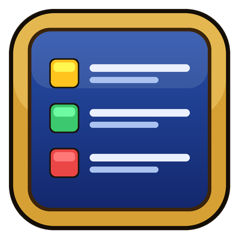
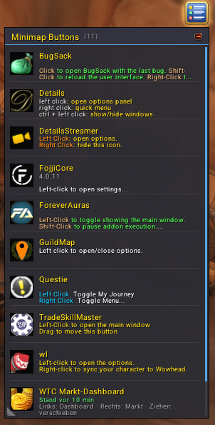
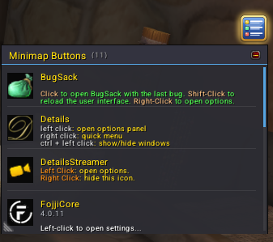
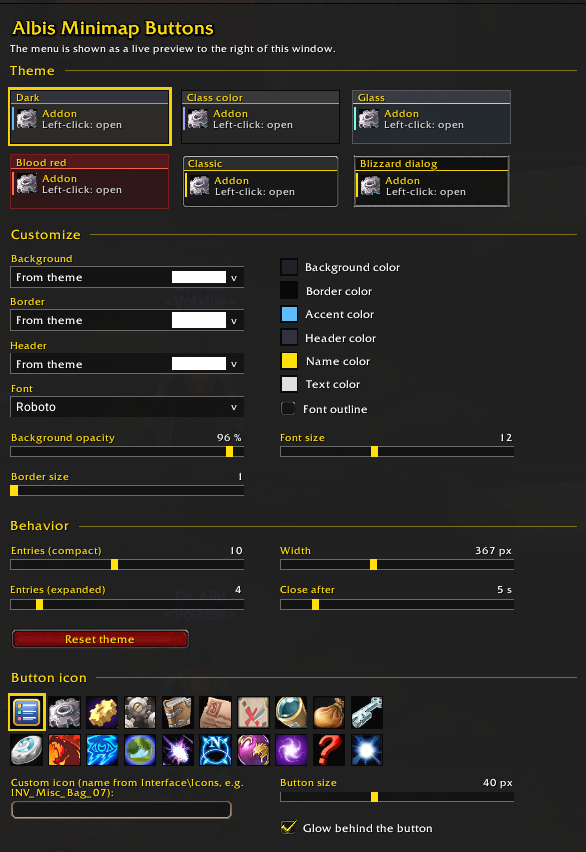
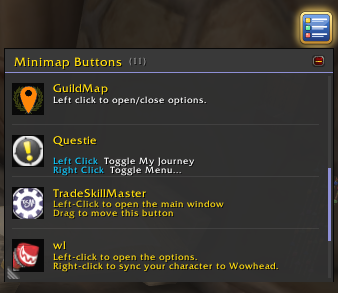
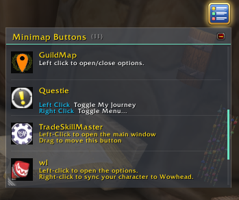
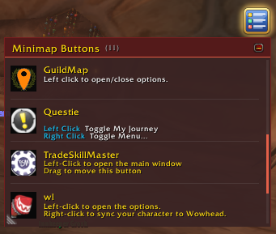
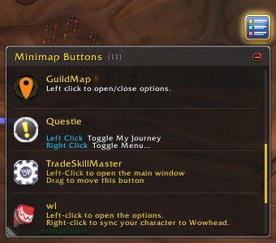
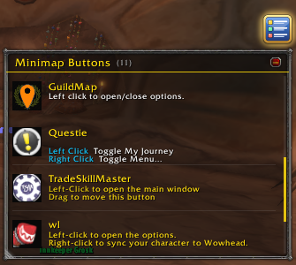

# Albis Minimap Buttons

**One button instead of twenty.** Albis Minimap Buttons collects all your minimap buttons into a single, clean, scrollable dropdown menu. Every entry shows the addon's icon, its name and what a click does, so you never have to hover over tiny icons again.

## Features

- **Collects every minimap button.** Works with LibDBIcon buttons and with addons that put their own buttons on the minimap.
- **Shows what each button does.** The click hints from the addon's tooltip appear right in the list ("Left-click: open options", "Right-click: …").
- **Sorted alphabetically, with mouse-wheel scrolling.** The menu remembers where you scrolled to.
- **Compact and expanded view.** Switch with the +/- button in the header, or resize by dragging the bottom corner.
- **Closes by itself** a few seconds after your mouse leaves it (adjustable).
- **6 themes:** Dark, Class color, Glass, Blood red, Classic and Blizzard dialog.
- **Fully customizable:** background, border, header texture, font, every color, opacity, border size and font size. Comes with a live preview right next to the options window.
- **SharedMedia support** plus 12 bundled fonts (SIL Open Font License).
- **Your own anchor button:** pick one of 20 icons or use any icon from Interface\Icons, set the size and turn the glow on or off.
- **Works with ElvUI.**
- **Translated into all WoW client languages:** English, German, French, Spanish (EU and Mexico), Italian, Brazilian Portuguese, Russian, Korean, Simplified and Traditional Chinese.

## Usage

- **Click** the button: open or close the menu
- **Right-click** the button: settings and themes
- **Drag** the button: move it anywhere

## Slash commands

| Command | What it does |
| --- | --- |
| `/amb config` | Open settings and themes |
| `/amb rows <n>` | Number of visible entries in the current view |
| `/amb width <px>` | Menu width |
| `/amb delay <s>` | Seconds until the menu closes |
| `/amb list` | List all collected buttons |
| `/amb ignore <name>` / `/amb unignore <name>` | Exclude or include a button |
| `/amb scan` | Search for buttons again |
| `/amb reset` | Reset the position |

## Good to know

- Please don't use it together with other minimap button collectors such as MinimapButtonButton or MBB. They fight over the same buttons.
- If a button is missing, use `/amb scan`. If something shows up that shouldn't be there, use `/amb ignore <name>` (the name is shown in `/amb list`).

## Feedback

Bugs und Wünsche gerne als GitHub-Issue (mit Addon-Name und ggf. BugSack-Fehlertext). / Please open a GitHub issue with the addon name and, if possible, the BugSack error text.

---

## Deutsch

**Ein Button statt zwanzig.** Albis Minimap Buttons sammelt alle Minimap-Buttons in einem übersichtlichen, scrollbaren Dropdown-Menü. Jeder Eintrag zeigt Icon, Name und was ein Klick bewirkt.

- Sammelt LibDBIcon-Buttons und andere Buttons an der Minimap
- Klick-Hinweise der Addons direkt in der Liste
- Alphabetisch sortiert, Mausrad-Scrollen, merkt sich die Position
- Kompakte und erweiterte Ansicht, Größe per Ziehen an der Ecke
- Schließt sich nach einigen Sekunden von selbst
- 6 Designs, alles anpassbar, Live-Vorschau im Optionsfenster
- SharedMedia-Unterstützung und 12 mitgelieferte Schriften
- Eigenes Button-Icon, Größe und Leuchten einstellbar
- Funktioniert mit ElvUI
- In allen WoW-Clientsprachen übersetzt

**Bedienung:** Klick öffnet das Menü, Rechtsklick öffnet die Einstellungen, Ziehen verschiebt den Button. Alle Befehle zeigt `/amb`.

Bitte nicht zusammen mit anderen Minimap-Button-Sammlern wie MinimapButtonButton verwenden.

---

*Code: MIT License. Bundled fonts: SIL Open Font License 1.1 (see Licenses folder).*

## Installation

Den Ordner `AlbisMinimapButtons/` nach `World of Warcraft/<_anniversary_|_classic_era_|_retail_|_forever_>/Interface/AddOns/` kopieren.

Copy the `AlbisMinimapButtons/` folder into your `Interface/AddOns/` folder.

## Screenshots

